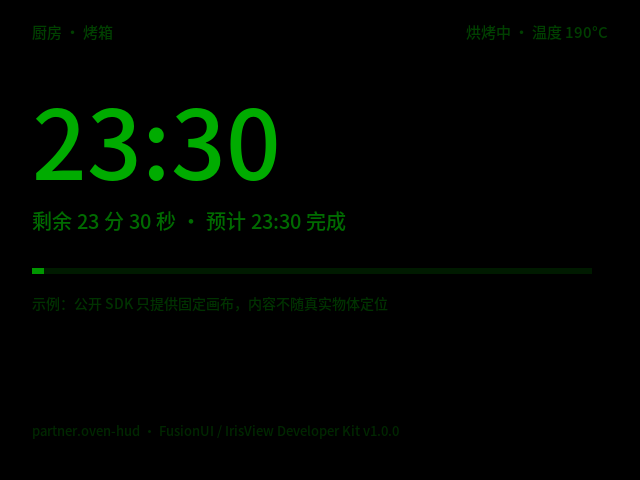

# 用 IrisView 智能眼镜做“真实物体旁 HUD”的可行性调研

**案例：在烤箱旁显示“还有多久结束”**

> 调研依据：`IrisView Developer Kit v1.0.0`（含 Runtime、Client、Simulator、SDK）与 `IrisView Platform Alpha 中英双语版 v3` 开发文档。
> 文档为 Alpha 版本，接口与能力可能变化；本文结论以当前交付包为准。
> 结论分三档：✅ 可行 ｜ ⚠️ 有条件可行 ｜ ❌ 当前不可行。

---

## 一、结论先行

### 1.1 一句话结论

**用这套 SDK 做“做饭时抬眼就能看到烤箱倒计时”的固定 HUD，可行，且已在本机跑通；做“把倒计时钉在烤箱旁边、转头后仍停在原处”的空间锚定 HUD，当前不可行。**

### 1.2 分项目结论

| 目标形态 | 可行性 | 说明 |
|---|---|---|
| 视野中常驻的倒计时卡片（做饭时抬眼可见） | ✅ 可行 | 公开 SDK 的标准用法；本次已构建、打包并在模拟器运行验证 |
| 倒计时随头移动、始终在固定屏幕位置 | ✅ 可行 | 这正是当前显示模型的默认行为（画面相对视野固定） |
| 倒计时“贴”在烤箱旁，转头后仍停在烤箱位置 | ❌ 不可行 | 应用无法设置窗口在世界中的位姿，也没有头部位姿/空间锚点输入 |
| 自动识别烤箱并把标签叠上去 | ❌ 不可行 | 无相机、无深度、无物体检测、无锚点 API |
| 用双目视差让卡片“浮”到近处 | ⚠️ 有限 | 有 `setSpatialDepth`，但量程只有几个像素级视差，官方明确“不是米制距离” |
| 切到别的应用后倒计时仍常驻 | ❌ 不可行 | 显示前台独占；系统级 Dashboard 卡片通道在本 Kit 中关闭 |
| 读取烤箱真实剩余时间 | ⚠️ 取决于数据源 | 眼镜看不到烤箱面板；需烤箱 API / 智能插座 / 用户手动设定时 |

### 1.3 建议

1. **把产品目标从“空间锚定”改为“视线常驻 + 场景化信息设计”**：倒计时固定在视野一角，用图标、亮度、进度条承载语义。这是当前硬件/平台最擅长、也最容易做出体验的形态。
2. **先做 L0 原型（1～2 周）**，同时向平台方确认光学参数（虚像距离、FOV、亮度）与设备是否具备相机/IMU。
3. **若“必须贴在烤箱上”是硬指标**：不要在当前 DevKit 上硬做。需要平台开放窗口位姿/空间锚点/相机，或改用具备 6DoF + 空间锚点的 MR 形态设备；否则只能做视频后期合成，不能作为真实功能交付。

---

## 二、这个平台是什么：一份“显示眼镜”的画像

### 2.1 分离渲染：手机算布局，眼镜只负责画

IrisView 的核心是**分离渲染**：宿主（手机/电脑）运行应用、计算布局与文字排版，眼镜端只做绘制、图层合成与显示。参考方案使用 BES2800BP，8.3 MB 片上共享 SRAM 由系统、连接与显示共用。

这带来两个直接后果：

- 业务逻辑、网络请求、AI 调用都在宿主侧完成，眼镜侧资源很紧；
- **眼镜端不提供“世界理解”能力**，它拿到的是一棵已经排好版的 2D 界面树。

参见[技术架构](IrisView-Platform-Alpha-中英双语版-v3/平台开发文档/IrisView-Developer/architecture.html)与[核心概念](IrisView-Platform-Alpha-中英双语版-v3/平台开发文档/IrisView-Developer/concepts.html)。

```
烤箱 API / 手动计时  →  宿主：业务逻辑 + 布局排版  →  眼镜：绘制 / 合成 / 显示
                              ✗ 无头部位姿   ✗ 无空间锚点
                              ✗ 无相机/深度  ✗ 无物体语义
```


### 2.2 显示：640×480、单绿/全彩、固定画布

- 参考方案覆盖**单绿与全彩**两种显示；文档中的双目单绿配置为**每眼 640 × 480**。
- 本 Kit 的 Client 镜像默认取**左眼 640×480**；运行包信息里的视觉报告编码为 `lossless-indexed-L8-green`，即**8 位绿色索引色**（全彩是另一套显示配置）。
- 应用创建窗口时使用 `setSize([0.64, 0.48, 0.01])`，单位是米；它描述的是一个 0.64×0.48 m 的虚拟面，**并不告诉应用这个面在世界中的位置**。画布坐标是 640×480 像素。示例代码见[构建界面](IrisView-Platform-Alpha-中英双语版-v3/平台开发文档/IrisView-Developer/ui.html)。
- 模拟器默认单目预览，`--display-mode stereo` 可并排查看双眼画面（见[兼容性](IrisView-Platform-Alpha-中英双语版-v3/平台开发文档/IrisView-Developer/Devkit/docs/zh-CN/manuals/compatibility.html)与[模拟器指南](IrisView-Platform-Alpha-中英双语版-v3/平台开发文档/IrisView-Developer/simulator-guide.html)）。

**关键点：应用输出的是“一帧 640×480 的平面画面”，不是“空间中的一个 3D 物体”。** 按单绿透视显示的常见行为，黑色区域基本不发光（具体透过率需实测），所以可以只点亮画面的一角，做出“小卡片悬浮在视野里”的观感；但这一角的位置是**相对屏幕**的，不是相对世界的。

### 2.3 应用能拿到什么：只有“显示 + 有限输入”

应用清单可声明的能力包括：

| 能力 | 用途 |
|---|---|
| `input.navigation` | 方向、确认、返回 |
| `input.text` | 键盘文字提交（无系统输入法弹窗） |
| `input.audio` | 16 kHz / 单声道 / 16-bit PCM，单次最长 60 秒 |
| `input.game-controls` | 游戏式按键 |
| `media.playback` | 播放/暂停/切歌等媒体意图 |
| `display.keep-awake` | 前台运行时保持显示 |
| `dashboard.provider` | 系统看板卡片（本 Kit 未启用） |

**没有**相机；除麦克风外也没有 IMU、眼动、手势、深度、平面检测、空间锚点、窗口位姿等能力。SDK 的 `os` 模块里与设备相关的只有电量、显示电源状态、语言、输入与媒体。参见[应用能力](IrisView-Platform-Alpha-中英双语版-v3/平台开发文档/IrisView-Developer/Devkit/docs/zh-CN/manuals/application_capabilities.html)与 [`os/index.d.ts`](IrisView-Developer-Kit-v1.0.0/sdk/public-api/os/index.d.ts)。

窗口 API 也只有标题与尺寸：

```js
const p = WindowProperty.create();
p.setTitle("烤箱倒计时");
p.setSize([0.64, 0.48, 0.01]);   // 米；宽、高、厚
const win = Window.create(p);    // 没有位置、朝向、锚点参数
```

### 2.4 连接与运行边界

- Client 支持 **BlueZ（蓝牙）或 TCP** 两种传输；真机走蓝牙 GATT（包信息中 `gatt_profile_version=1`）。
- 常驻场景（racer）目标帧率 **30 fps**；会话心跳 1 s、租约 10 s。
- 文档明确提醒：**宿主息屏后能否继续更新，取决于宿主系统的后台执行与连接机制**；断连/暂停后要继续显示，必须自己管理内容有效期，避免展示过期信息。

参见 `runtime/PACKAGE_INFO.txt` 与[技术架构](IrisView-Platform-Alpha-中英双语版-v3/平台开发文档/IrisView-Developer/architecture.html)的“设备验证”一节。

### 2.5 平台里确实有“空间能力”的线索，但不在应用层

[开发者文档首页](IrisView-Platform-Alpha-中英双语版-v3/平台开发文档/IrisView-Developer/index.html)称其覆盖“轻量化 AR 眼镜、MR 头显”，[MR 介绍](IrisView-Platform-Alpha-中英双语版-v3/平台开发文档/IrisView-Developer/mr.html)也展示了“用射线移动空间窗口”的交互。进一步检查随包 native 库，可以看到：

- `XRCameraManager_*`、`XRCameraConfig_*`（相机）
- `XREnvironment_notifySpatialAnchorCreateCompletionEvent`（空间锚点）
- `XRHandTrackingService_*`（手部跟踪）
- `XRSeWindow_getPose / setPose / registerPoseChangedCallback`（窗口位姿）

这些符号出现在 `libxrvendorsdk.so`、`libxrsesdk.so` 等 XR 运行时库中，但公开的 JS 应用桥接与 SDK 里没有对应的类型、能力或入口。合理推断：平台的 MR/引擎层具备相机、锚点、手部与窗口位姿能力，但**当前 v1.0.0 DevKit 面向“显示眼镜”，没有把这层能力开放给第三方应用**。这也解释了为什么 MR 演示能移动窗口，而普通应用连“窗口在哪”都不知道。

> 注意：这只能说明“底层可能有”，不能说明“眼镜形态一定有相机/IMU”，更不能说明“第三方可用”。需要向平台方确认。

---

## 三、需求拆解：一个“烤箱旁倒计时”到底需要什么

把需求拆成 8 个子能力，逐项对照：

| 子能力 | 对“烤箱旁 HUD”的要求 | 平台现状 | 判定 |
|---|---|---|---|
| 数据 | 烤箱剩余时间、温度、模式 | 无设备直连；需宿主侧接 API/手动输入 | ⚠️ |
| 内容 | 大字号倒计时、进度、完成态 | 2D 文本/容器/图片/动画齐全 | ✅ |
| 显示 | 在厨房照度下清晰可读 | 单绿 640×480；亮度/FOV 未公开 | ⚠️ |
| 注册 | 标签固定在烤箱的世界位置 | 无位姿、无锚点、无相机 | ❌ |
| 遮挡 | 标签被近处物体正确遮挡 | 无深度缓冲/深度 API | ❌ |
| 交互 | 开始/延长/取消 | 导航键、语音、文字输入 | ✅ |
| 常驻 | 做饭全程可见，切应用不消失 | 前台独占；后台不绘制 | ❌ |
| 可靠性 | 断连/息屏/恢复后时间仍准确 | 需应用自己用时间戳重算 | ⚠️ |

**结论：内容与交互都能做；数据接入取决于烤箱是否可联网；“注册”和“常驻”是硬缺口。**

---

## 四、三个硬约束：为什么“贴物体”做不到

### 4.1 没有位姿：不知道头在哪，也不知道烤箱在哪

要在世界坐标中固定一个标签，显示系统必须知道**头部的实时位姿**，再反算标签应出现在屏幕的哪个像素。当前应用 API：

- 没有头部位姿/IMU 数据；
- 没有窗口位姿设置接口；
- 没有空间锚点（world anchor）的创建、持久化、查询接口；
- 没有相机帧，无法做视觉定位或物体识别。

因此应用能做的只有“在 640×480 画布上画东西”。这个画布相对视野固定，**用户转头时标签跟着头走**——这正是“头戴 HUD”而不是“世界 HUD”。

### 4.2 没有深度/遮挡：标签永远浮在最上层

即使通过某种方式把标签画到了烤箱附近，没有深度信息就无法：

- 判断烤箱在前景还是背景；
- 让标签被桌沿、手、锅具正确遮挡；
- 在双目中给出正确的辐辏/遮挡关系。

结果就是标签“像贴纸一样糊在画面上”，一动就穿帮。真正的物体锚定 HUD 需要深度或至少单目 SLAM + 平面/物体检测，这些都不在 SDK 中。

### 4.3 光学：焦面和视差量程都不支持“近处贴合”

这是最容易被忽略、但决定体验的一条。

- 文档没有给出**虚像距离（焦面）**、FOV、亮度、透过率。头戴显示通常在某一固定距离成像（多数产品在 1.5～3 m 或更远，因产品而异）；如果 HUD 清晰，近处 0.6～1 m 的烤箱就会失焦，反之亦然。**“同时看清烤箱和贴在烤箱上的字”在固定焦面光学上本身就是一个矛盾**。
- SDK 唯一的“深度”手段是 `FusionRoot.setSpatialDepth(widget, depth)` 与 `setSpatialDisparityScale(scale)`：
  - 它把控件放在“双目舒适平面”上，`depth ∈ [-1, 1]`，正数更近、负数更远；
  - 视差量程：默认 scale=1 时，depth=1 对应左右眼 **4/640** 的画面分离；最大 scale=3 时为 **12/640**；
  - 官方注释明确说明：该范围**不是光学舒适度保证，也不是以米为单位的距离**；单目/2D 输出下不会产生立体效果。

做个量级估算（假设水平 FOV 约 30°、图像宽 640 px、IPD 63 mm；“视差”指左右眼画面的总分离量）：

| 视差 | 角度 | 估算融合距离 |
|---|---|---|
| 4 px（默认） | ≈0.19° | ≈19 m |
| 12 px（最大 scale=3） | ≈0.56° | ≈6.4 m |
| 要达到 1 m | ≈3.6° | ≈77 px（远超 API 上限） |
| 要达到 0.6 m | ≈6.0° | ≈128 px |

即使把 FOV 放宽到 35° 或收紧到 25°，最大视差对应的距离也仍在 **5～8 m** 量级。**换句话说：这套双目视差只能让内容在“远处几米”的范围内浮一点，无法把 HUD 拉到灶台前 1 m 的位置。** 而且若显示焦面在 2 m 附近（仅为示例），强行加大视差会造成调节-辐辏冲突，容易重影、眼酸。

> 以上是基于公开参数的敏感度估算，不是设备实测；但结论对 FOV 在 20°～40° 的合理范围都成立。

---

## 五、能落地的四个层级

| 层级 | 形态 | 体验 | 实现 | 成本 | 风险 |
|---|---|---|---|---|---|
| **L0** | 头戴固定倒计时卡片 | 抬眼可见，转头跟随 | 纯 FusionUI 2D | 1～2 周原型 | 不在物体旁；可能遮挡视线 |
| **L1** | 场景化布局（角落/顶部/多卡片） | 更像“厨房 HUD” | 纯 2D 布局 + 状态机 | 2～4 周 | 仍是头戴固定；切应用消失 |
| **L2** | 系统级空间窗口（用户手动把窗口停到烤箱旁） | 转头后仍在原处 | 依赖 MR 形态/系统 shell 的窗口位姿 | 应用侧 1～2 周验证 | 本 Kit 不支持；应用仍不知物体语义 |
| **L3** | 真·物体锚定（自动识别烤箱并贴标签） | 所见即所得 | 6DoF + 相机 + 锚点 + 检测 + 标定 | 平台级，6～12 个月+ | 当前 SDK 完全不可行 |

### 5.1 L0：已经验证过的形态

本次用公开 SDK 写了一个最小应用：

- 640×480 全屏画布，黑底绿字；
- 96 px 大号倒计时，1 Hz 更新；
- 进度条、完成态、初始占位；
- 生命周期暂停/恢复，时间用时间戳重算，避免后台挂起导致走时不准。

构建、打包、在模拟器运行均通过（本机为 Fedora，运行前临时绕过了 Kit 的 Ubuntu 检查，见附录 B）。实际画面：



> 这是模拟器/Client 左眼预览的真实截图（640×480），不是设计稿。截图中的倒计时正在按秒递减，说明文本、布局、秒级更新与呈现链路可用。
> PoC 源码：[src/index.ts](src/index.ts)。为了便于观察，PoC 用了全屏排版；实际产品可以缩成右上角 200×100 的小卡片，其余保持黑色（透视）。

**这个 PoC 证明了什么：**

- 应用可以稳定地创建窗口、绘制文字/色块、按秒更新；
- 增量更新（只改变化的文本/宽度）足够轻，1 Hz 完全在能力范围内；
- 生命周期、时间戳重算、初始占位这些“工程正确性”都可以在 SDK 内完成。

**它也证明了什么做不到：**

- 画面中的所有元素都固定在画布坐标里；没有任何 API 能让卡片跟随烤箱；
- 单目预览下没有立体深度；双目下也只能把融合距离在数米范围内微调；
- 没有“烤箱”这个对象的任何信息——它只是一个文本字符串。

### 5.2 L1：把“场景感”做出来，而不是“空间感”

在 L0 基础上可以做的体验优化：

- **固定位置**：倒计时永远在右上角，用户形成肌肉记忆（这是大多数 HUD 的做法）；
- **多任务**：烤箱、空气炸锅、电饭煲三行小卡片，按剩余时间排序；
- **状态语义**：预热/烘烤/完成用亮度、闪烁、进度条、图标区分（单绿显示下不要依赖颜色）；
- **语音开始/延长**：做饭时手上有油，语音比触控更合理；
- **完成提醒**：眼镜端没有面向应用的系统通知/TTS API，提醒交给手机（震动/铃声），眼镜只负责“看得见”。

这些都是纯 2D 能力，却能覆盖大部分真实需求。

### 5.3 L2：如果目标是 MR 形态，存在一条“中间路线”

平台的 MR 演示里有“用射线移动窗口”的交互，native 库也有窗口位姿接口。若目标设备是具备 6DoF 的 MR 头显，且系统允许：

1. 用户把一个小窗口手动停到烤箱旁；
2. 系统让窗口在世界中保持位姿（world-locked）；
3. 应用在这个窗口里画倒计时。

这样能得到“转头后仍在原处”的效果，**但应用仍然不知道窗口旁边是不是烤箱**——它只是恰好在那个位置。标签与物体的对齐靠用户手动摆放，不是自动识别。

**这条路线在当前 DevKit 上无法验证**：公开应用 API 没有窗口位姿入口，文档也没有面向第三方应用的“空间窗口”API。需要 MR 设备 + 系统支持 + 平台确认。

### 5.4 L3：真·物体锚定，需要补一整条链路

见第七节。

---

## 六、数据从哪来：比“显示”更现实的问题

“还有多久结束”这句话的前提是**知道烤箱的状态**。眼镜没有相机，看不到烤箱面板；应用只能拿到宿主侧能给的数据。

| 数据源 | 能拿到什么 | 适用性 | 注意 |
|---|---|---|---|
| 智能烤箱 / 厂商云 API | 剩余时间、温度、模式 | 最理想 | 需授权、联网、厂商开放；离线不可用 |
| Home Assistant / Matter | 统一设备状态 | 较现实 | 需要家庭网关与设备支持 |
| 智能插座（功率监测） | 功率下降≈结束 | 对“哑”烤箱的折中 | 只能推断“可能结束”，不是精确剩余时间 |
| 用户手动设定时 | 用户输入的时长 | 100% 可用 | 本质是“计时器”，不是“读烤箱” |
| 蓝牙温度探针 | 食物中心温度 | 烘焙场景加分 | 需确认手机侧 BLE 连接数/带宽是否够用 |

**必须向产品方明确：** 如果烤箱本身不联网，HUD 显示的只能是“用户设定的倒计时”，不是烤箱真实的剩余时间。这两者在宣传上差别很大，不能混为一谈。

---

## 七、如果一定要做 L3，需要补什么

### 7.1 设备/系统层

- 6DoF SLAM（至少 3DoF + 磁力计，但 3DoF 无法做位置锚定）；
- RGB 相机（做物体检测）与/或深度相机（做遮挡与平面）；
- IMU（低延迟头追）；
- 世界锚点 API：创建、持久化、跨会话恢复、共享；
- 平面/物体检测，或允许应用上传自定义识别模型；
- 深度遮挡（让虚拟内容被真实物体正确遮挡）；
- 显示-眼睛标定：IPD、畸变、亮度、焦面。

### 7.2 应用/算法层

- 烤箱检测（模板/检测模型），或用手势/语音辅助“框选”；
- 锚点绑定与重定位（烤箱被移动、光照变化时）；
- 在锚点坐标系下渲染 billboard（始终朝向用户）或贴面面板；
- 置信度与失败态：识别不到时退回 L0 卡片，而不是硬贴。

### 7.3 工作量粗估

| 路线 | 周期 | 前提 |
|---|---|---|
| 等平台开放锚点/位姿/相机 API | 取决于平台 roadmap | 平台方愿意开放，且眼镜硬件具备传感器 |
| 换用成熟 6DoF MR 平台（自研应用） | 3～6 个月 | 设备可用、SDK 成熟；但仍需自己做烤箱检测与标定 |
| 自研眼镜硬件 + 系统 | 12 个月+ | 团队、供应链、光学/算法能力 |

这不是“应用层多写几行代码”能解决的差距。

---

## 八、光学与可读性：决定“能不能用”的细节

文档没有给出以下参数，必须向厂商索取或真机实测：

| 参数 | 为什么重要 | 建议验证方法 |
|---|---|---|
| 虚像距离/焦面 | 决定 HUD 与近处物体能否同时清晰 | 看 1 m/2 m/3 m 处物体时，HUD 是否同时清楚 |
| FOV | 决定卡片能占多大、文字能多小 | 量测屏幕上 100 px 对应的视角 |
| 亮度/透过率 | 厨房高照度下是否看得清 | 300/500/1000 lux 环境下的对比度测试 |
| 单绿/全彩色深 | 决定能否用颜色区分状态 | 用状态图实测；单绿方案改用亮度与形状 |
| 刷新/拖影 | 转头时文字是否糊 | 快速左右转头观察 |
| 重量/佩戴 | 40 分钟做饭是否舒适 | 30～60 分钟佩戴测试 |
| 功耗/发热 | 全程常亮是否撑得住 | 满电连续显示计时 |

**单绿 + 640×480 的设计建议：**

- 主数字 ≥ 64 px（PoC 用了 96 px），关键标签 ≥ 20 px，辅助说明 ≥ 14 px（PoC 中 13～15 px 的辅助文字已接近可读下限，真机需复核）；
- 不要用细线字体，优先中等字重（包内自带 SourceHanSansSC-Medium）；
- 用亮度层级（240/150/70）而不是颜色表达主次；
- 进度条比小数点更抗抖；
- 避免大面积高亮，减少透视下的眩光与遮挡。

---

## 九、落地建议

### 9.1 两周内可以做什么

1. 用 L0 卡片做一个可用的“厨房多计时器”：
   - 语音/手机设定时；
   - 眼镜右上角常驻，按剩余时间排序；
   - 完成时手机提醒，眼镜显示“完成”；
   - 断连显示“—”，恢复后用时间戳重算。
2. 真机验证光学与佩戴（见第八节）。
3. 与烤箱/HA 做一次数据打通 PoC（有设备的话）。

### 9.2 两个月内可以验证什么

- 真实厨房环境下的可读性（不同照度、不同背景）；
- 长时间运行的稳定性（40～60 分钟、断连重连、手机息屏）；
- 用户是否接受“固定角落”的心智模型（这是 L0 成败的关键）；
- 是否值得为“贴物体”投入平台级改造。

### 9.3 不建议现在做的事

- 不要在应用层伪造“世界锚定”（例如用手机 IMU 猜朝向再偏移画布）——没有眼镜位姿，误差不可控，转头就穿帮；
- 不要把“视频后期合成”的效果当作功能承诺；
- 不要在没有光学参数的情况下承诺“贴在烤箱上仍清晰”。

---

## 十、待向平台方确认的问题清单

1. 本代眼镜是否具备 IMU/相机？是否对第三方应用开放？
2. 是否有窗口位姿（world-locked window）或空间锚点 API？计划何时开放？
3. 虚像距离、FOV、亮度、透过率、刷新率、重量、续航的具体参数？
4. 后台/息屏时，宿主应用能否持续更新眼镜画面？`display.keep-awake` 的边界是什么？
5. Dashboard/常驻卡片通道在本 Kit 中为何关闭？量产版本是否会开启？
6. MR 形态设备的窗口位姿是否持久化？第三方应用能否创建/查询空间窗口？
7. 眼镜是否支持立体显示下的逐控件视差？`setSpatialDepth` 在真机上的舒适范围是多少？

---

## 附录 A：证据索引

| 结论 | 依据 |
|---|---|
| 分离渲染、8.3 MB SRAM | [技术架构](IrisView-Platform-Alpha-中英双语版-v3/平台开发文档/IrisView-Developer/architecture.html) |
| 双目单绿 640×480、单绿/全彩 | [技术架构](IrisView-Platform-Alpha-中英双语版-v3/平台开发文档/IrisView-Developer/architecture.html) |
| 窗口/画布/文本 API | [构建界面](IrisView-Platform-Alpha-中英双语版-v3/平台开发文档/IrisView-Developer/ui.html)、[核心概念](IrisView-Platform-Alpha-中英双语版-v3/平台开发文档/IrisView-Developer/concepts.html) |
| 能力清单（未含相机/空间能力） | [应用能力](IrisView-Platform-Alpha-中英双语版-v3/平台开发文档/IrisView-Developer/Devkit/docs/zh-CN/manuals/application_capabilities.html) |
| 单目预览、640×480 | [模拟器指南](IrisView-Platform-Alpha-中英双语版-v3/平台开发文档/IrisView-Developer/simulator-guide.html) |
| 宿主机限制、Ubuntu 白名单 | [兼容性](IrisView-Platform-Alpha-中英双语版-v3/平台开发文档/IrisView-Developer/Devkit/docs/zh-CN/manuals/compatibility.html)、[排错指南](IrisView-Platform-Alpha-中英双语版-v3/平台开发文档/IrisView-Developer/Devkit/docs/zh-CN/manuals/known_issues.html) |
| MR 空间窗口演示 | [MR 介绍](IrisView-Platform-Alpha-中英双语版-v3/平台开发文档/IrisView-Developer/mr.html) |
| 左眼 640×480、L8 绿、30 fps、心跳/租约 | [`runtime/PACKAGE_INFO.txt`](IrisView-Developer-Kit-v1.0.0/runtime/PACKAGE_INFO.txt) |
| 窗口只有标题/尺寸 | [`sdk/public-api/os/index.d.ts`](IrisView-Developer-Kit-v1.0.0/sdk/public-api/os/index.d.ts) |
| 双目舒适平面/视差量程 | [`sdk/public-api/types/core/FusionRoot.d.ts`](IrisView-Developer-Kit-v1.0.0/sdk/public-api/types/core/FusionRoot.d.ts) |
| native 层相机/锚点/手部/窗口位姿符号 | `runtime/lib/libxrvendorsdk.so`、`libxrsesdk.so` 符号表 |

## 附录 B：PoC 复现

环境：Ubuntu 22.04/26.04（Kit 白名单）、Node.js **24.13.0**、npm **11.6.2**。

仓库根目录就是应用工程：`src/`（TypeScript）、`FusionUIApp.json`、`fusionui.config.json`
与 `package.json` 放在一起。`.node-version` 由 Vite+ 管理，锁定 Node 24.13.0；
`verify`/`build` 会先用 `tsc` 编译到 `build/`，再交给 Kit。

推荐用 `vp run`（自动使用 pin 的 Node）：

```bash
vp env install      # 首次：安装 .node-version 指定的 Node
npm install         # 安装 TypeScript devDependency
vp run typecheck    # 只做 TypeScript 类型检查
vp run compile      # tsc -> build/
vp run verify       # 类型检查 + 编译 + Kit test
vp run build        # 构建到 dist/
vp run package      # 生成未签名调试包 release/oven-hud.fuiapp
vp run start        # 单目运行（模拟器）
vp run run:stereo   # 双目并排运行
vp run dry-run      # 只打印启动计划，不拉起进程
vp run doctor       # Kit 环境诊断
vp run dev          # build + package + start
vp run clean        # 删除 build/、dist/ 与 release/
```

`npm run <script>` 同样可用：`scripts/kit.sh` 发现当前 Node 不是 24.13.0 时，
会自动通过 Vite+ 解析 `.node-version` 并切换到 pin 的 Node。

脚本分层：

- `scripts/kit.sh`：定位 Kit、切换 Vite+ Node、注入 `IRISVIEW_STATE_DIR`；
- `scripts/preflight.mjs`：检查 Node 版本、Kit 路径、`package`/`run` 的前置条件；
- `scripts/irisview.py`：开发用包装器，在非 Ubuntu 主机上临时绕过 Kit 的
  OS 白名单（打印警告；`IRISVIEW_STRICT_HOST=1` 可关闭）。

常用覆盖项：

```bash
# Kit 不在默认位置时
IRISVIEW_KIT=$HOME/IrisView/LLVISION/IrisView-Developer-Kit-v1.0.0 vp run build

# 不用 Vite+，直接指定 24.13.0 的 bin 目录
IRISVIEW_NODE_BIN=$HOME/.nvm/versions/node/v24.13.0/bin vp run build

# 把 Kit 的 state 目录放到工作区（默认 ~/IrisView-Developer-Kit-Data）
IRISVIEW_STATE_DIR=$PWD/.state vp run start
```

说明：

- 本机为 Fedora 44，不在 Kit 的 Ubuntu 白名单内；开发模式下由 `scripts/irisview.py`
  绕过并打印警告。**生产/交付仍应使用 Ubuntu。**
- 构建需要精确的 Node 24.13.0 / npm 11.6.2；Kit 会在启动时校验版本，
  `vp run` 与 `scripts/kit.sh` 会自动切到 pin 的版本。
- `package` 需要 Git 提交身份；本仓库已在根目录 `git init` 并完成初始提交。
- 截图来自模拟器 release 配置的单目预览（左眼 640×480）。

## 附录 C：方法与局限

- 本调研以静态文档 + SDK 类型定义 + 随包二进制符号 + 一次模拟器运行验证为依据；
- **没有真机**，因此光学（焦面、FOV、亮度）、佩戴、功耗、蓝牙时延均未实测；
- “头戴固定（head-referenced）”是从 API 与渲染路径得出的架构推断，文档未用这句话描述；
- 视差距离估算是基于 FOV/IPD 假设的敏感度分析，不是厂商参数；
- 文档为 Alpha，后续版本可能开放更多能力，结论需随版本复核。
